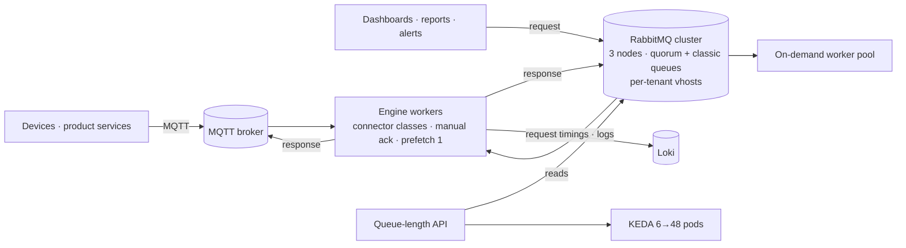

# Messaging Layer: RabbitMQ Cluster Migration & Engine Connectors

 -lightgrey) 

> **Architecture write-up.** This documents work I did as a DevOps Engineer at Faclon Labs (Mumbai). The implementation belongs to my employer and is not published; what follows is the design, the moving parts and the outcomes, with internal names and details left out.

The platform's compute engine evaluates expressions over device data —
consumption by shift, day or month, run times, rolling intervals, cluster
aggregations — for dashboards, reports and alerts. It serves **150–200
requests a minute** at peak and has an on-demand worker pool that floods when
a customer rewrites historical data. Every request and every answer travels
over RabbitMQ or MQTT. I own that layer: I designed the engine's RabbitMQ and
MQTT client classes, moved the broker to a **3-node cluster with zero
downtime**, made delivery safe against worker failure, and proposed and
prototyped the **Polars** rewrite that made the next engine version **~40%
faster**.

## The problem

The engine talked to a single broker through ad-hoc connection code. Messages
were auto-acknowledged on receipt, so a worker that died mid-computation lost
the request. A single node was a single point of failure and a ceiling on
throughput, and a growing product needed per-tenant isolation (virtual hosts)
and a path to replace the broker without stopping production.

## Architecture

## What I built

**Connector classes.** One RabbitMQ handler and one MQTT handler used by every
worker: connection management against a list of cluster brokers with
failover, dynamic virtual hosts per tenant, quorum or classic queues chosen
per workload, prefetch of one with manual acknowledgement, request/response
publishing with correlation, and a log client that publishes execution logs
back to the platform. The same classes carried over into the engine's next
major version.

**Zero-downtime cluster migration.** Workers were switched to the new 3-node
cluster broker by broker: the connectors accepted the new broker list and
vhosts while the old broker still served, queues were mirrored on the cluster,
producers were repointed last, and the old node was drained and retired. No
request was dropped and nothing was paused.

**Delivery safety.** Auto-ack was removed. A worker acknowledges only after it
has published the answer, so a crash or a scale-down mid-computation means a
redelivery, not a silent loss. With prefetch of one, a flooded queue is shared
evenly across the pool, which is what lets KEDA scale it on queue length (see
the autoscaling write-up).

**Transport for compute reports.** Report generation moved from direct calls
onto the same queues, with its own vhost, so it scales and fails the same way
as everything else.

**Polars proof of concept.** I proposed replacing pandas with Polars for the
engine's data frames and built the proof of concept; the team then rewrote the
engine around it. Response times, measured from the per-request timings the
engine ships to Loki through the logging library I wrote, dropped by about
40%.

## Outcomes

- **3-node RabbitMQ cluster**, migrated with **zero downtime**.
- No lost requests on worker failure or scale-down.
- **150–200 requests/min** at peak served through the connectors.
- **~40% faster responses** after the Polars rewrite the proof of concept led to.
- Per-tenant isolation through dynamic vhosts; one connector code path for
  every worker type.

## Stack

RabbitMQ (cluster, quorum and classic queues, vhosts) · MQTT · Python · Polars · Loki · KEDA

## My role

Designed and wrote the connector classes, planned and executed the cluster
migration, removed auto-ack across the workers, built the compute-report
transport, and proposed and prototyped the Polars rewrite. I also review and
merge pull requests on the engine's repositories.
